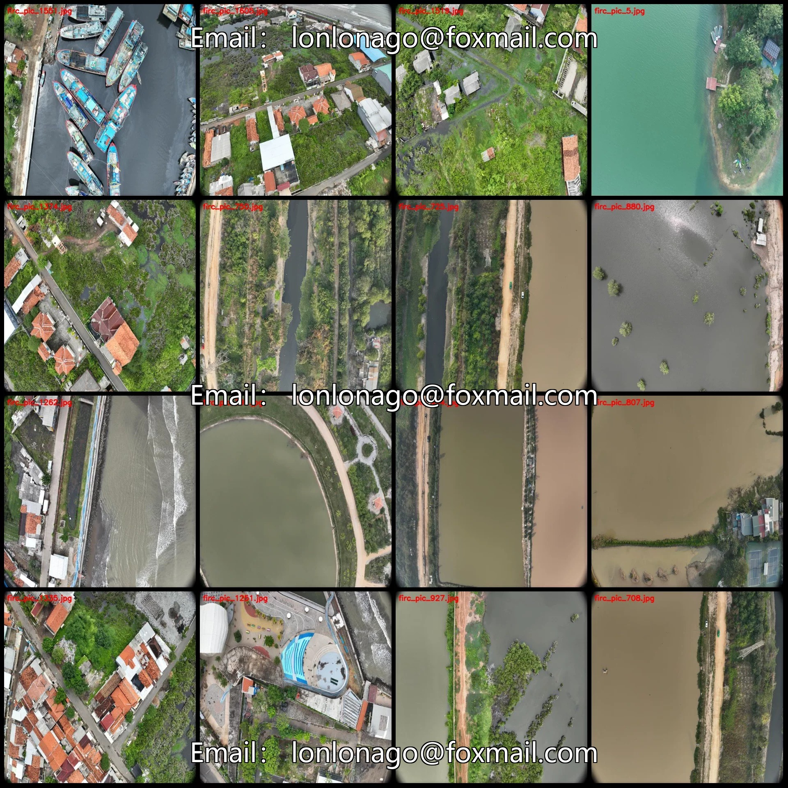
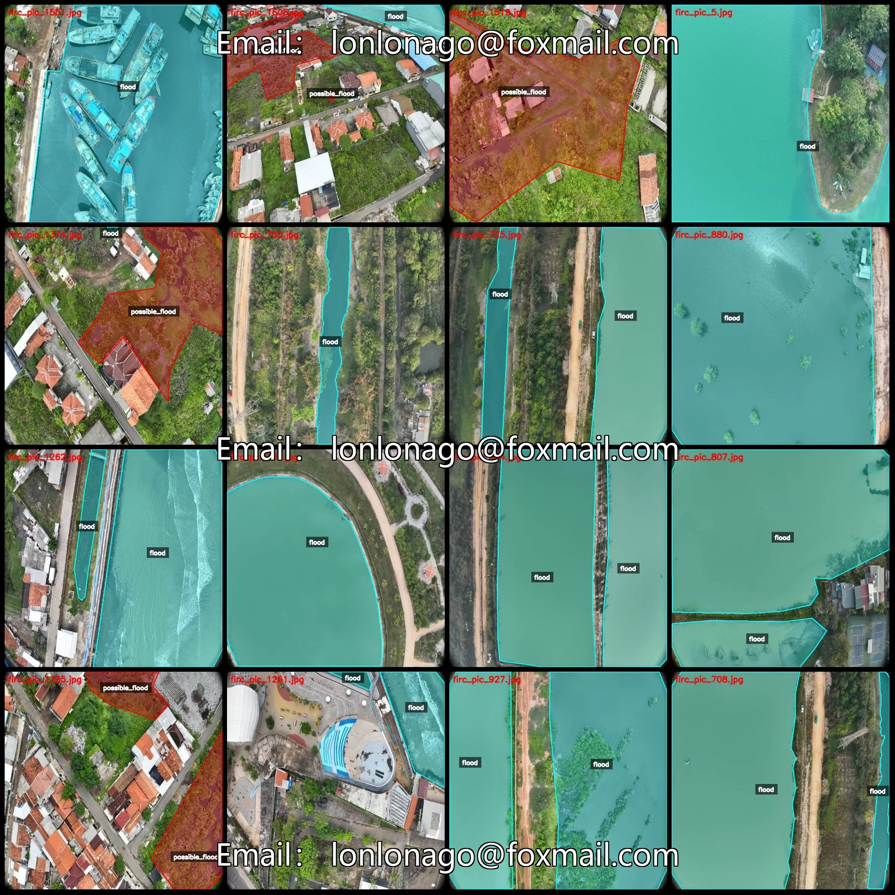
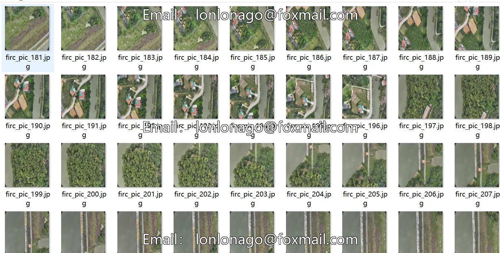
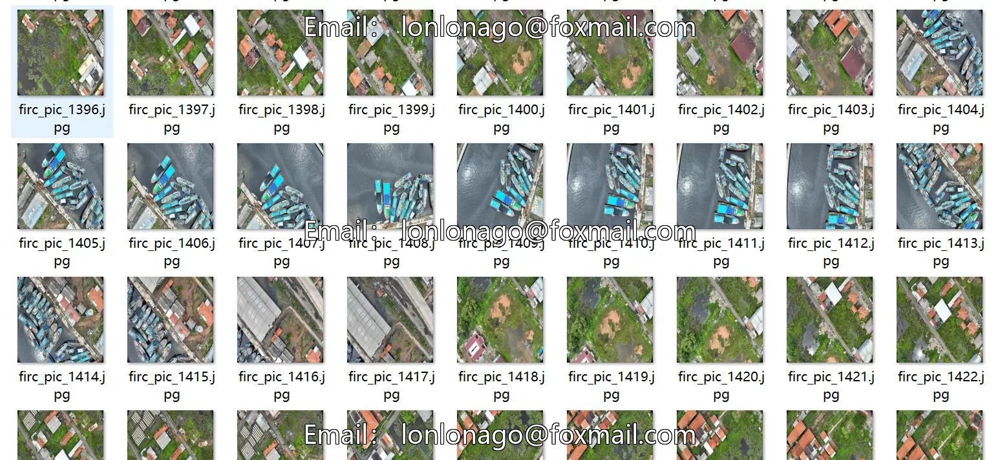
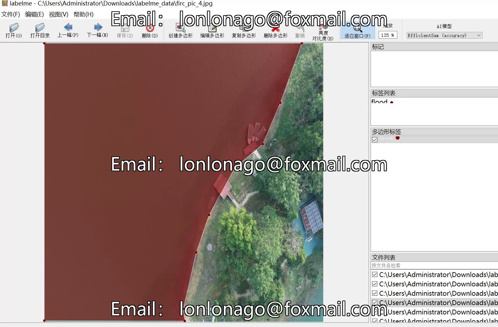

# Drone-view aerial photography flood area identification and segmentation dataset labeled in LabelMe format 161

## Body

Drone-View Aerial Photography Flood Area Identification and Segmentation Dataset - LabelMe Format: 1617 Images in 2 Categories
Warm Reminder: Due to the dataset's replicability, please confirm compliance with requirements before purchasing.
Note: The images in the dataset are formed by extracting frames from a video, which results in many repeated images (not duplicates but continuous images formed by the video). Those who are sensitive to this may not purchase. After purchase, if you claim that there are too many repetitions of images, we will not refund.
Dataset Format: LabelMe Format (excluding mask files, only including jpg images and corresponding json files)
Number of Images (Number of jpg files): 1617
Number of Annotations (Number of json files): 1617
Number of Annotation Categories: 2

Annotation Category Names: ["flood", "possible_flood"]
Number of boxes per category:
- flood count = 3544
- possible_flood count = 324
Total Boxes: 3868
Using Annotation Tool: labelme=5.5.0
Image Resolution: 640x640
Annotation Rules: Polygonize the category with polygons
Important Note: The dataset can be opened and edited using labelme, but JSON datasets need to be converted into mask or yolo format or coco format for semantic segmentation or instance segmentation.

Special : This dataset does not guarantee the accuracy of the trained models or weight files.

## Images

## Payment

Here is a pay link on Stripe ( https://buy.stripe.com/3cs8yP7sY87d0vu9AB ). Please contact me lonlonago@foxmail.com after funding $89, and I will send you a complete data files , thank you!

